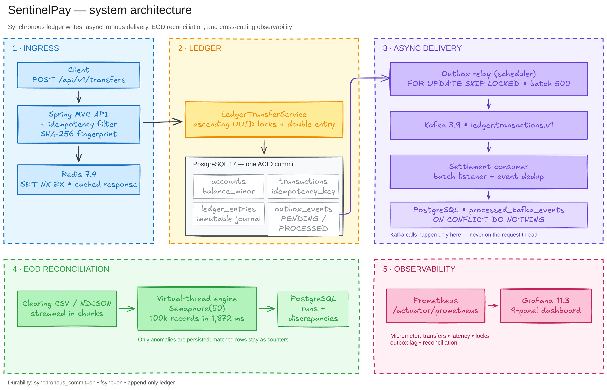
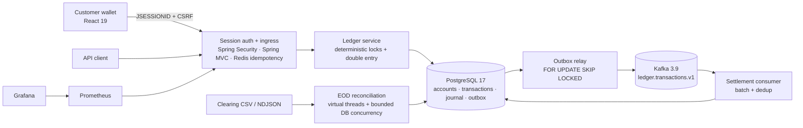
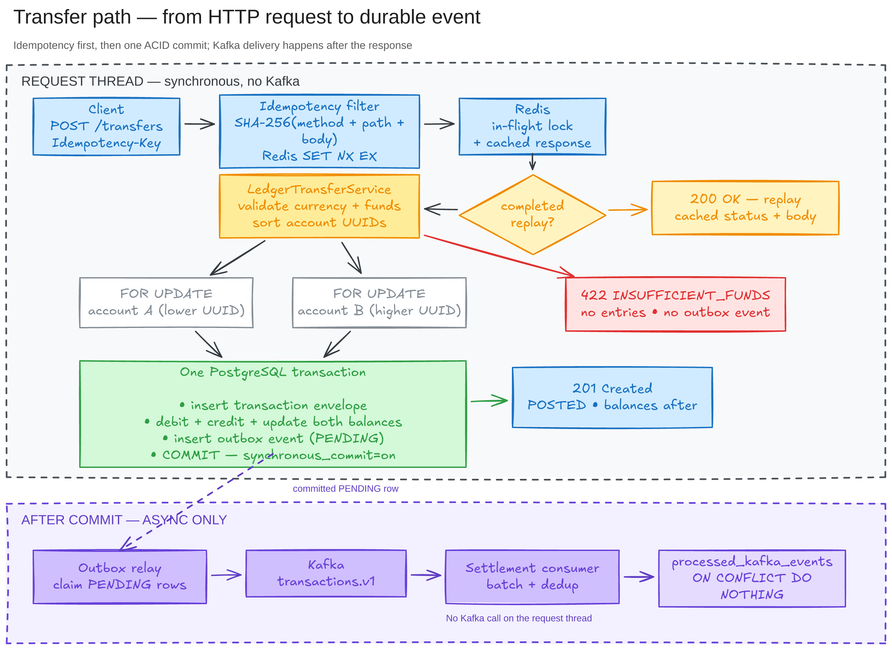

# SentinelPay

**A double-entry payments ledger and end-of-day settlement engine built to survive concurrency, crash and broker failure.**

SentinelPay is a Java 21 / Spring Boot 3.5 service backed by PostgreSQL, Redis and Kafka. It accepts account and transfer requests, posts immutable double-entry journal lines, publishes events through a transactional outbox, and reconciles 100,000-record clearing files with bounded virtual-thread concurrency. A bundled React wallet gives signed-in customers a private-ledger view of balances, statements and a server-computed proof of their own journal; Grafana remains the operator surface.

The project is deliberately built around three failure modes that break naive payment services:

| Failure mode | What goes wrong | How SentinelPay handles it |
| --- | --- | --- |
| Concurrent double-spend | Two requests read the same balance and both think the money is available. | Redis `SET NX EX` ingress idempotency + deterministic UUID lock ordering + `SELECT ... FOR UPDATE` + a conditional non-negative balance constraint. |
| Floating-point / balance drift | `0.1 + 0.2` is not `0.3`; a materialised balance stops matching the journal. | Amounts are signed `BIGINT` minor units only. Every transfer writes a balanced debit/credit pair, `balance_minor = SUM(entries)` is auditable, and ledger entries are append-only at the database level. |
| Dual-write inconsistency | The database commits but Kafka never receives the event, or Kafka receives an event for a rolled-back payment. | The event is written to `outbox_events` in the same PostgreSQL transaction. A relay publishes it with `FOR UPDATE SKIP LOCKED`; Kafka consumers deduplicate by event ID so at-least-once delivery becomes effectively once. |

## Contents

- [Architecture](#architecture)
- [Transfer path](#transfer-path)
- [Customer wallet](#customer-wallet)
- [Quick start](#quick-start)
- [API](#api)
- [Error model](#error-model)
- [Guarantees and tests](#guarantees-and-tests)
- [Benchmark](#benchmark)
- [Trade-offs and limitations](#trade-offs-and-limitations)
- [Roadmap](#roadmap)
- [Operations](#operations)
- [Project layout](#project-layout)
- [Decision records](#decision-records)

## Architecture

Four planes keep the hot path free of external I/O:



Editable source: [`docs/diagrams/architecture.excalidraw`](docs/diagrams/architecture.excalidraw). The rendered data-plane diagram predates the customer session layer; the React wallet reaches the same API through Spring Security with a `JSESSIONID` and CSRF token.

<details>
<summary>Mermaid version</summary>


</details>

1. **Authentication, ingress and idempotency** — Spring Security authenticates `/api/**`, requires CSRF on mutations and resolves account ownership from the session principal. A `OncePerRequestFilter` then hashes the request and takes an atomic Redis lock before any database connection is borrowed. Redis is an optimisation; the `transactions.idempotency_key` unique constraint is the durable backstop.
2. **ACID ledger** — account rows are locked in ascending UUID order, so A→B and B→A cannot form a circular wait. The transaction envelope, both balance updates, two journal entries and the outbox event commit atomically.
3. **Asynchronous delivery** — the relay claims pending outbox rows in bounded batches, publishes them with the transaction ID as the Kafka key, and bulk-marks the batch processed. Consumers insert `processed_kafka_events` and perform side effects in the same transaction.
4. **EOD reconciliation** — a streaming parser reads the clearing file in chunks; each chunk runs on a Java 21 virtual thread, bounded by a semaphore so it cannot stampede HikariCP. Matched rows are counted; anomalies are persisted with their type and transaction reference.

## Transfer path



Editable source: [`docs/diagrams/transfer-flow.excalidraw`](docs/diagrams/transfer-flow.excalidraw).

<details>
<summary>Mermaid sequence version</summary>

```mermaid
sequenceDiagram
    autonumber
    participant C as Client
    participant F as Idempotency filter
    participant R as Redis
    participant S as LedgerTransferService
    participant P as PostgreSQL
    participant O as Outbox relay
    participant K as Kafka

    C->>F: POST /api/v1/transfers + Idempotency-Key
    F->>R: SET NX EX in-flight fingerprint
    alt completed duplicate
        F-->>C: cached response (201 replayed as 200)
    else winner
        F->>S: decoded request body
        S->>P: SELECT FOR UPDATE sorted account UUIDs
        S->>P: validate status, currency, available balance
        S->>P: INSERT transaction + update 2 balances + 2 entries + outbox
        P-->>S: COMMIT
        S-->>F: 201 TransferResponse
        F->>R: cache completed response
        F-->>C: 201 Created
    end
    Note over O,K: Scheduler polls outbox rows; no Kafka call on the request thread
    O->>P: claim PENDING rows, FOR UPDATE SKIP LOCKED
    O->>K: publish batch keyed by transaction ID
    O->>P: mark PROCESSED
    K-->>O: acknowledgements
```
</details>

The original transfer row is never mutated. A reversal is a new `REVERSAL` transaction with inverse entries linked through `reversal_of`; the effective status of the original is derived as `REVERSED`.

## Customer wallet

The customer app is a React 19 / Vite 7 / TypeScript application bundled into the Spring Boot static resources. It reads as a contemporary private-ledger statement rather than a neobank: bone paper, ultramarine and oxblood accents, ruled statements, Schibsted Grotesk for interface text and IBM Plex Mono for figures and references. No gradients, glass panels, ornamental cards or animated counters.

| Route | Purpose |
| --- | --- |
| `/` | Public product page: specimen statement, journal mechanics, proof and engineering guarantees |
| `/login`, `/register` | Real session login, registration and logout |
| `/wallet` | Server-computed currency totals, accounts and recent activity |
| `/wallet/send` | Review-first transfer form for the customer's own accounts |
| `/wallet/activity` | Cursor-paginated statement with transaction detail |
| `/wallet/proof` | Per-account journal proof: materialised balance, ledger sum, drift and entry count |

Authentication uses an `HttpOnly` `JSESSIONID` plus a CSRF cookie/header pair; there is no token in `localStorage` and no fake client-side login. The session determines account ownership, so the browser never sends `ownerId`. The server computes every total, running balance and proof figure in integer minor units; the UI formats those integers and never performs money arithmetic.

Customers can see and spend from only their own accounts; a transfer destination may belong to another customer, but directly querying a foreign account or transaction returns `404`. Reversals and reconciliation are `ROLE_ADMIN` operations exposed through the API and Grafana/operator tooling, not the customer wallet. A transaction detail shown to a customer masks counterparty running balances while still showing the balanced journal structure.

To work on the UI with the API running on `:8080`:

```bash
cd frontend
npm ci
npm run dev      # Vite on :5173, proxies /api to localhost:8080
npm run build    # typechecks, then writes src/main/resources/static
```

## Quick start

Requirements: Docker Engine with Compose v2, JDK 21 and Maven (or the included `./mvnw`).

```bash
# PostgreSQL 17, Redis 7.4, Kafka 3.9, Prometheus and Grafana
docker compose up -d --wait

# Spring Boot on http://localhost:8080. The operator account is optional and
# created only when both variables are supplied; customers can self-register.
SENTINELPAY_ADMIN_USERNAME=operator \
SENTINELPAY_ADMIN_PASSWORD='change-this-password' \
./mvnw spring-boot:run
```

Open `http://localhost:8080/` for the public product page, then `http://localhost:8080/login` for the customer wallet. Register a customer, or sign in with the bootstrapped operator account. The operator role is required for reversals and reconciliation; it is never selected by the customer UI.

If ports `5432`, `6379` or `9092` are already in use, override them for both Compose and the app:

```bash
SENTINELPAY_POSTGRES_PORT=5433 \
SENTINELPAY_REDIS_PORT=6380 \
SENTINELPAY_KAFKA_PORT=19092 \
SENTINELPAY_GRAFANA_PORT=3001 \
docker compose up -d --wait

SENTINELPAY_DB_URL=jdbc:postgresql://localhost:5433/sentinelpay \
SENTINELPAY_REDIS_PORT=6380 \
SENTINELPAY_KAFKA_BOOTSTRAP_SERVERS=localhost:19092 \
./mvnw spring-boot:run
```

Grafana is at `http://localhost:3001` (`admin` / `admin`) and Prometheus at `http://localhost:9090` when using the override above. Override `SENTINELPAY_PROMETHEUS_PORT` as well if `9090` is occupied.

### Create an account and move money

Sessions are cookie-based and every mutating request needs a CSRF token. With `curl`, keep a cookie jar and fetch a fresh token after login because Spring Security rotates it. The account owner comes from the session; do not send `ownerId`.

```bash
BASE=http://localhost:8080
JAR=/tmp/sentinelpay.cookies

# 1. Register a customer (public endpoint)
CSRF=$(curl -sS -c "$JAR" "$BASE/api/v1/auth/csrf" | sed -E 's/.*"token":"([^"]+)".*/\1/')
curl -sS -b "$JAR" -c "$JAR" -H "X-XSRF-TOKEN: $CSRF" \
  -H 'Content-Type: application/json' \
  -d '{"username":"alice","displayName":"Alice","password":"correct-horse-battery"}' \
  "$BASE/api/v1/auth/register"

# 2. Log in, then refresh the CSRF token for the authenticated session
curl -sS -b "$JAR" -c "$JAR" -H "X-XSRF-TOKEN: $CSRF" \
  -H 'Content-Type: application/x-www-form-urlencoded' \
  --data-urlencode 'username=alice' \
  --data-urlencode 'password=correct-horse-battery' \
  "$BASE/api/v1/auth/login"
CSRF=$(curl -sS -b "$JAR" -c "$JAR" "$BASE/api/v1/auth/csrf" \
  | sed -E 's/.*"token":"([^"]+)".*/\1/')

# 3. Two funded accounts; each initial deposit is a double-entry DEPOSIT from SYSTEM_RESERVE
curl -sS -b "$JAR" -H "X-XSRF-TOKEN: $CSRF" -H 'Content-Type: application/json' \
  -d '{"currency":"INR","initialDepositMinor":1000000}' "$BASE/api/v1/accounts"
curl -sS -b "$JAR" -H "X-XSRF-TOKEN: $CSRF" -H 'Content-Type: application/json' \
  -d '{"currency":"INR","initialDepositMinor":0}' "$BASE/api/v1/accounts"

# 4. Use the two accountId values from the responses
curl -sS -b "$JAR" -H "X-XSRF-TOKEN: $CSRF" \
  -H 'Content-Type: application/json' -H 'Idempotency-Key: demo-transfer-0001' \
  -d '{"sourceAccountId":"<source-uuid>","destinationAccountId":"<destination-uuid>","amountMinor":25000,"currency":"INR","description":"demo"}' \
  "$BASE/api/v1/transfers"

# 5. Audit certificate and customer overview/proof
curl -sS -b "$JAR" "$BASE/api/v1/accounts/<account-uuid>/audit"
curl -sS -b "$JAR" "$BASE/api/v1/me/overview"
curl -sS -b "$JAR" "$BASE/api/v1/accounts/<account-uuid>/transactions?limit=20"
```

A transfer returns `201` the first time and `200` with `Idempotency-Replayed: true` when the same key and payload are retried.
Response fields: account creation returns `accountId`, `ownerId`, `currency`, `balanceMinor`, `status`; a transfer
returns `transactionId`, `idempotencyKey`, `status`, `amountMinor`, `currency`, `sourceBalanceMinorAfter`,
`destinationBalanceMinorAfter`, `createdAt`; the audit certificate returns `accountId`, `materializedBalanceMinor`,
`ledgerBalanceMinor`, `driftMinor`, `entryCount`, `transactionsBalanced`, `checkedAt`.

The complete clean-clone quick start, including the async outbox/Kafka path, is recorded in
[`docs/results/verification.md`](docs/results/verification.md#clean-clone-quick-start). That historical
check predates session authentication; the commands above are the current contract.

## API

All endpoints except `GET /api/v1/auth/csrf`, `POST /api/v1/auth/login` and `POST /api/v1/auth/register` require an authenticated session. Mutating requests additionally require `X-XSRF-TOKEN` matching the `XSRF-TOKEN` cookie. Foreign customer resources return `404` rather than `403` so identifiers cannot be probed.

| Method | Path | Purpose | Success |
| --- | --- | --- | --- |
| `GET` | `/api/v1/auth/csrf` | Issue/refresh the CSRF token (public) | `200` |
| `POST` | `/api/v1/auth/register` | Register a customer (public) | `201`, `409` |
| `POST` | `/api/v1/auth/login` | Start a session (public) | `200`, `401` |
| `POST` | `/api/v1/auth/logout` | Invalidate the session | `204` |
| `GET` | `/api/v1/auth/me` | Current user and role | `200`, `401` |
| `POST` | `/api/v1/accounts` | Create an account owned by the session, optionally funded | `201` |
| `GET` | `/api/v1/accounts/{accountId}` | Read an owned account (admin: any) | `200`, `404` |
| `GET` | `/api/v1/me/accounts` | List the session owner's accounts | `200` |
| `GET` | `/api/v1/me/overview` | Server-computed totals, accounts, recent activity and proof | `200` |
| `GET` | `/api/v1/accounts/{accountId}/transactions` | Cursor-paginated activity (`limit`, `cursor`) | `200`, `404` |
| `GET` | `/api/v1/transactions/{transactionId}` | Balanced transaction detail (counterparty balances masked) | `200`, `404` |
| `POST` | `/api/v1/transfers` | Post a double-entry transfer (`Idempotency-Key` required) | `201` new, `200` replay |
| `POST` | `/api/v1/transactions/{transactionId}/reverse` | Compensating reversal (`ROLE_ADMIN`, `Idempotency-Key` required) | `201` new, `200` replay |
| `GET` | `/api/v1/accounts/{accountId}/audit` | Audit certificate with `driftMinor` and journal checks | `200` |
| `POST` | `/api/v1/reconciliation/run` | Upload a CSV/NDJSON clearing file + `businessDate` (`ROLE_ADMIN`) | `200` summary |
| `GET` | `/api/v1/reconciliation/runs/{runId}` | Read a reconciliation run (`ROLE_ADMIN`) | `200`, `404` |
| `GET` | `/api/v1/reconciliation/runs/{runId}/discrepancies` | Paginated anomalies, optional `type` (`ROLE_ADMIN`) | `200` |

Full request/response contracts: [`SPECIFICATION.md` §8.2](SPECIFICATION.md#82-rest-api-contracts).

## Error model

All errors are RFC 7807 `application/problem+json` with a stable `code`, `title`, `detail`, `instance` and domain fields such as `availableMinor` or `lineNumber`.

| Status | Code | Typical cause |
| --- | --- | --- |
| `400` | `INVALID_REQUEST`, `INVALID_AMOUNT`, `IDEMPOTENCY_KEY_REQUIRED` | Malformed JSON, invalid UUID/amount, missing header |
| `401` | `UNAUTHENTICATED`, `INVALID_CREDENTIALS` | No session, expired session or wrong username/password |
| `403` | `FORBIDDEN` | Authenticated but not an administrator, or missing/invalid CSRF token |
| `404` | `ACCOUNT_NOT_FOUND`, `TRANSACTION_NOT_FOUND`, `RECONCILIATION_RUN_NOT_FOUND`, `NOT_FOUND` | Unknown resource, or a foreign customer resource hidden as not found |
| `409` | `IDEMPOTENCY_IN_FLIGHT`, `IDEMPOTENCY_CONFLICT`, `USERNAME_TAKEN` | Same key still running, reused with a different payload, or duplicate registration |
| `422` | `INSUFFICIENT_FUNDS`, `CURRENCY_MISMATCH`, `ACCOUNT_NOT_ACTIVE`, `REVERSAL_NOT_ALLOWED` | Domain rule rejected the request |
| `503` | `DEPENDENCY_UNAVAILABLE` | PostgreSQL/Hikari temporarily unavailable |
| `500` | `INTERNAL_ERROR` | Unexpected failure; no database details are leaked |

Extended taxonomy: [`SPECIFICATION.md` §8.3](SPECIFICATION.md#83-error-taxonomy-rfc-7807-problemdetail).

## Guarantees and tests

The integration suite runs against real PostgreSQL, Redis and Kafka containers. No infrastructure is mocked.

| Phase | Gate | What it proves |
| --- | --- | --- |
| 1 | `./mvnw test -Dtest=SchemaMigrationIT` | Flyway applies V1–V4; append-only triggers on the journal and transactions; sign constraints; partial outbox index; D-1/D-2 rules |
| 2 | `./mvnw test -Dtest=ConcurrencyStressIT` | Exactly the funded number of concurrent transfers succeed; zero deadlocks; net balances preserved |
| 3 | `./mvnw test -Dtest=OutboxResilienceIT` | Kafka outage leaves events pending; all arrive after recovery; consumer dedup works |
| 4 | `./mvnw test -Dtest=ReconciliationEngineIT` | 100,000 records, exactly 100 anomalies, engine well under the 5,000 ms gate |
| 5 | `./mvnw test -Dtest=MetricsIT` | Required Prometheus families and tags are exported |
| 6 | `./mvnw test -Dtest=AuthIT` | Registration, login/logout, CSRF, unauthenticated `401`, ownership isolation and admin-only operations |
| 7 | `./mvnw test -Dtest=WalletReadIT` | Server-computed totals/proof, cursor pagination, balanced detail and cross-customer isolation |
| all | `./mvnw verify` | Full unit/integration suite from a clean checkout |

Final suite measured on 2026-11-09 (details and counts in [`docs/results/verification.md`](docs/results/verification.md)):

| Gate | Result |
| --- | --- |
| `SchemaMigrationIT` | PASS — 9 tests |
| `LedgerTransferIT` + `ReversalAuditIT` + `LedgerInvariantIT` | PASS — 13 tests |
| `ConcurrencyStressIT` | PASS — 2 concurrency scenarios, zero deadlocks |
| `IdempotencyIT` | PASS — 5 tests |
| `KafkaConsumerIT` + `OutboxResilienceIT` + `OutboxDeadLetterIT` | PASS — 4 tests, including broker pause/recovery and dead-letter exhaustion |
| `ReconciliationEngineIT` | PASS — 2 tests, 100,000 records in 2,209 ms |
| `MetricsIT` | PASS — 1 test |
| `AuthIT` | PASS — 6 tests |
| `WalletReadIT` | PASS — 4 tests |
| **Full suite** | **PASS — 46 tests, 0 failures, 0 errors, 0 skipped in 62.0 s** |

The load gate is reported separately below. It was **not weakened** to make the build green.

## Benchmark

### Environment

| Item | Value |
| --- | --- |
| Host | Intel Core i5-9300H, 4 cores / 8 hardware threads, 15.8 GB RAM, ext4 NVMe |
| Runtime | Temurin JDK 21.0.13, Spring Boot 3.5.16, packaged executable JAR |
| Data services | PostgreSQL 17 and Kafka 3.9 in Docker, Redis 7.4 in Docker |
| Load generator | Gatling 3.16 on the same host |
| Durability | `synchronous_commit=on`, `fsync=on`, `full_page_writes=on` (deliberately not relaxed) |
| Application settings | HikariCP pool 50–60, Kafka batch listener, outbox batch 500 / poll 50 ms |

The host is shared with a desktop session and other containers. It is a 4-core-class laptop, not a dedicated benchmark machine. Storage is the limiting resource: PostgreSQL commits are WAL-fsync-bound, and the same host also runs the load generator and broker.

### Results

The official benchmark numbers below were measured **before session authentication was added**. The current API adds a servlet session lookup and the Spring Security filter chain to every request, so treat these as the pre-authentication ledger capacity of this host. The official gate has not been re-run at 2,500 rps because it already failed on the pre-auth code; the authenticated path is validated separately by the smoke run below.

**Official Phase 5 gate** — 2,500 requests/s target, 60 s ramp, 120 s hold, 90% transfers / 10% audits, open-model Gatling:

| Metric | Result |
| --- | ---: |
| Sustained requests offered | 300,000 in 120 s |
| Successful requests | 115,486 (38.5%) |
| Failed requests | 184,514 (61.5%, all `503 DEPENDENCY_UNAVAILABLE`) |
| Successful transfer throughput | **962 rps** |
| p50 / p95 / p99 | **2,017 / 2,142 / 3,041 ms** |
| Outbox pending / oldest lag after drain | 0 / 0 s |
| Gate | **FAIL** — throughput, p99 and error rate targets missed |

Gatling's own throughput assertion printed 1,587 rps because it counts every sustained request
(including the 503s) and divides by the full 189 s run, not the 120 s hold. The honest
successful-commit rate is `115,486 / 120 s = 962 rps`. The assertions were not relaxed.

**4-vCPU container-limited check** — 2026-11-05, same simulation with a total 4.0 vCPU budget
(app 2.5, PostgreSQL 1.0, Kafka 0.25, Redis 0.25; Gatling on the host):

| Metric | Result |
| --- | ---: |
| Sustained requests offered | 300,000 in 120 s |
| Successful requests | 51,702 (17.2%) |
| Failed requests | 248,298 (82.8%, all `503`) |
| Successful transfer throughput | **431 rps** |
| p50 / p95 / p99 | **2,035 / 2,824 / 3,224 ms** |
| Gate | **FAIL** — throughput, p99 and error rate targets missed |

The report screenshot is [`docs/results/gatling-cgroup-4vcpu.png`](docs/results/gatling-cgroup-4vcpu.png)
and the limits are in [`docker/benchmark/docker-compose.cpu-limits.yml`](docker/benchmark/docker-compose.cpu-limits.yml).
Post-run integrity was clean: **0** drift, **0** unbalanced transactions, **0** pending outbox events.

**Authenticated-path smoke** — 2026-11-09, 20 rps target over a 2 s ramp and 4 s hold, 200 accounts, 64 pre-warmed real sessions. The simulation now logs in through `/api/v1/auth/login` and sends `JSESSIONID` plus `X-XSRF-TOKEN` on every measured request:

| Metric | Result |
| --- | ---: |
| Measured requests | 104 (21 ramp, 80 sustained, 3 error-path) |
| Failed requests | **0** |
| Error paths | duplicate create `201`, replay `200`, insufficient funds `422` |
| Sustained `Cnt/s` | 11.43 (target 20; Gatling averages over the full run including ramp and error phase) |
| p50 / p95 / p99 | 23 / 28 / 35 ms |
| Gate | **not a substitute** — the unchanged 2,500 rps / p99 < 25 ms assertions reported KO |

This run validates that real session authentication, CSRF and ownership checks work end-to-end under concurrency; it does not claim the official throughput gate. The app was started with `spring-boot:run`, which pins `-XX:TieredStopAtLevel=1` (C1 only), while the official benchmark used a packaged JAR with default JIT.

**Closed-loop capacity** — 10 concurrent clients, 45 s, same transfer endpoint:

| Metric | Result |
| --- | ---: |
| Requests | 41,799 |
| Throughput | **928.8 rps** |
| p50 / p95 / p99 | **7 / 16 / 73 ms** |
| HTTP 5xx | 0 |
| p99 < 25 ms | **FAIL** at measured capacity |

The host cannot offer 2,500 rps with a closed-loop client, so the open-model run above is the
authoritative gate. The closed-loop result shows the service is stable and error-free when
concurrency is bounded near the storage ceiling; latency, not correctness, is what degrades.

### Why the load target is not reachable here

PostgreSQL commits are WAL-fsync-bound on this laptop's shared NVMe. `pg_test_fsync -s 2` inside the
PostgreSQL container measured **450 fsync/s** and **891 fdatasync/s**; a durable transfer needs at
least one WAL sync. Group commit lifts the observed clean throughput to ~930 rps, but not to 2,500.
At higher offered rates the fixed 60-connection pool times out and the API returns explicit `503`
responses instead of weakening durability or silently dropping writes.

Under no load, 20 sequential transfers measured p50 10 ms, p95 18 ms and max 35 ms. There is no
tuning setting that makes p99 < 25 ms at 2,500 rps on this storage; the target needs faster durable
storage or a different commit/batching design.

Post-run integrity checks on the benchmark database: **0** accounts with balance/journal drift,
**0** unbalanced transactions, and **0** outbox events left pending. The full evidence, commands,
Gatling report path and [Grafana screenshot](docs/results/grafana-live.png) are in
[`docs/results/verification.md`](docs/results/verification.md).

## Trade-offs and limitations

- **Reversals can fail after the destination spends the money.** User wallets cannot go negative, so a reversal is a real transfer back and may return `422 INSUFFICIENT_FUNDS`. This is documented rather than silently allowing overdrafts; a production credit-ledger design would use a separate receivable/chargeback flow.
- **Redis is not the source of truth.** If Redis is lost, completed replays may be recomputed, but the database unique key still prevents a second debit.
- **The outbox relay holds a database transaction while waiting for Kafka acknowledgements.** This is bounded by batch size (500) and a 3-second per-batch send timeout. It is the price of keeping the request path free of Kafka I/O.
- **One PostgreSQL primary.** There is no sharding or cross-region replication. The benchmark is a single-node result.
- **Sessions are in-memory and node-local.** A multi-instance deployment needs sticky sessions or a shared store such as Spring Session Redis. OAuth2/SSO, MFA, API keys, fraud scoring, FX conversion and card-network integration remain outside this repository's scope.
- **Load target not met on this host.** The 2,500 rps / p99 < 25 ms assertion remains in the Gatling simulation and fails honestly on the documented laptop and under the 4.0-vCPU container budget. The measured capacity and the exact failure are in the benchmark section; the target is realistic only on a dedicated host with fast durable storage and a separate load generator. See the risk note in [`docs/IMPLEMENTATION_PLAN.md`](docs/IMPLEMENTATION_PLAN.md#8-risk-register).

## Roadmap

The MVP is complete. [`docs/ROADMAP.md`](docs/ROADMAP.md) tracks the remaining load-gate decision,
production hardening (shared sessions, retention/partitioning, alerting and deployment) and ledger
extensions. The cgroup-limited benchmark is complete and also failed honestly. The 2,500 rps /
p99 < 25 ms assertion stays in place until a recorded decision replaces it with measured evidence.

## Operations

- **Metrics** — `/actuator/prometheus` exports transfer outcomes, transfer/lock/commit latency histograms, outbox pending and lag, reconciliation discrepancies, JVM heap/threads and HikariCP pool state.
- **Dashboards** — Grafana provisioning is in [`docker/grafana`](docker/grafana); the nine-panel dashboard is [`sentinelpay.json`](docker/grafana/dashboards/sentinelpay.json). Prometheus scrapes every 5 seconds.
- **Health** — `/actuator/health`, plus liveness/readiness groups.
- **Retention** — `outbox_events` and `processed_kafka_events` grow monotonically in this MVP. A production deployment should add a retention job for processed rows while keeping ledger and transaction history.
- **Reconciliation input** — CSV or NDJSON with `external_ref, transaction_id, amount_minor, currency, status, settled_at`; malformed rows return `400` with `lineNumber`.

## Project layout

```text
src/main/java/com/sentinelpay
├── auth/            # users, password hashing, sessions, CSRF, admin bootstrap
├── common/          # ProblemDetail errors, Redis idempotency, metrics
├── ledger/          # accounts, transfers, reversals, audit, repositories, REST
├── wallet/          # server-computed overview, activity cursor, transaction detail
├── web/             # SPA forwarding for /login, /register, /wallet/**
├── outbox/          # relay, Kafka topic config, outbox metrics
├── settlement/      # Kafka consumer + effectively-once side effects
└── reconciliation/  # streaming parser, virtual-thread engine, run/anomaly API
src/main/resources/db/migration  # V1–V4 ledger, reconciliation, immutability and users
src/main/resources/static        # built customer wallet bundled into the executable JAR
frontend/                         # React 19 + Vite 7 + TypeScript customer app
src/test/java/com/sentinelpay     # Testcontainers integration gates + Gatling simulation
docker/                           # Prometheus, Grafana provisioning and dashboard
docs/                             # plan, ADRs, verification and benchmark records
docs/diagrams/                    # editable Excalidraw architecture and transfer-flow diagrams
```

## Decision records

- [TDR-001 — money as signed BIGINT minor units](docs/adr/TDR-001-minor-unit-bigint.md)
- [TDR-002 — deterministic UUID lock ordering](docs/adr/TDR-002-deterministic-lock-ordering.md)
- [TDR-003 — transactional outbox vs XA](docs/adr/TDR-003-transactional-outbox-vs-xa.md)
- [TDR-004 — append-only ledger and transaction triggers](docs/adr/TDR-004-append-only-ledger-trigger.md)
- [TDR-005 — virtual threads for reconciliation](docs/adr/TDR-005-virtual-threads-reconciliation.md)
- [TDR-006 — server-side sessions and CSRF for the customer wallet](docs/adr/TDR-006-session-auth-csrf.md)

The full design, PRD/TRD and schema source are in [`SPECIFICATION.md`](SPECIFICATION.md); the execution checklist is [`docs/IMPLEMENTATION_PLAN.md`](docs/IMPLEMENTATION_PLAN.md) and the forward plan is [`docs/ROADMAP.md`](docs/ROADMAP.md).
