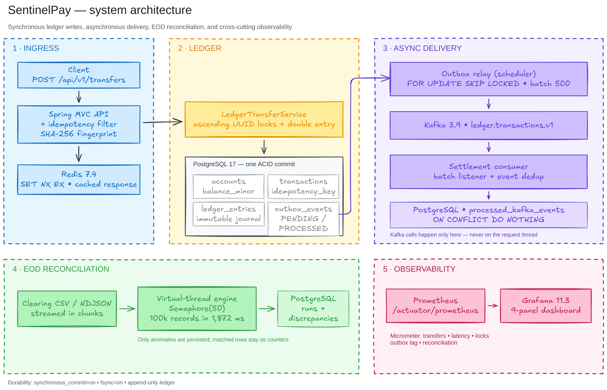
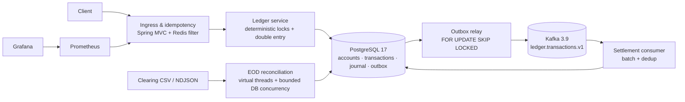
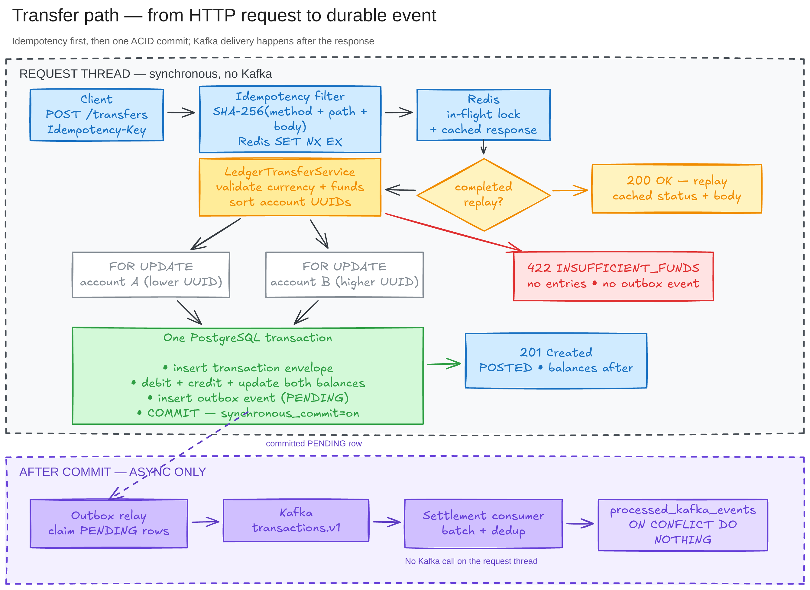

# SentinelPay

**A double-entry payments ledger and end-of-day settlement engine built to survive concurrency, crash and broker failure.**

SentinelPay is a Java 21 / Spring Boot 3.5 service backed by PostgreSQL, Redis and Kafka. It accepts account and transfer requests, posts immutable double-entry journal lines, publishes events through a transactional outbox, and reconciles 100,000-record clearing files with bounded virtual-thread concurrency.

The project is deliberately built around three failure modes that break naive payment services:

| Failure mode | What goes wrong | How SentinelPay handles it |
| --- | --- | --- |
| Concurrent double-spend | Two requests read the same balance and both think the money is available. | Redis `SET NX EX` ingress idempotency + deterministic UUID lock ordering + `SELECT ... FOR UPDATE` + a conditional non-negative balance constraint. |
| Floating-point / balance drift | `0.1 + 0.2` is not `0.3`; a materialised balance stops matching the journal. | Amounts are signed `BIGINT` minor units only. Every transfer writes a balanced debit/credit pair, `balance_minor = SUM(entries)` is auditable, and ledger entries are append-only at the database level. |
| Dual-write inconsistency | The database commits but Kafka never receives the event, or Kafka receives an event for a rolled-back payment. | The event is written to `outbox_events` in the same PostgreSQL transaction. A relay publishes it with `FOR UPDATE SKIP LOCKED`; Kafka consumers deduplicate by event ID so at-least-once delivery becomes effectively once. |

## Contents

- [Architecture](#architecture)
- [Transfer path](#transfer-path)
- [Quick start](#quick-start)
- [API](#api)
- [Error model](#error-model)
- [Guarantees and tests](#guarantees-and-tests)
- [Benchmark](#benchmark)
- [Trade-offs and limitations](#trade-offs-and-limitations)
- [Operations](#operations)
- [Project layout](#project-layout)
- [Decision records](#decision-records)

## Architecture

Four planes keep the hot path free of external I/O:



Editable source: [`docs/diagrams/architecture.excalidraw`](docs/diagrams/architecture.excalidraw).

<details>
<summary>Mermaid version</summary>


</details>

1. **Ingress and idempotency** — a `OncePerRequestFilter` hashes the request and takes an atomic Redis lock before any database connection is borrowed. Redis is an optimisation; the `transactions.idempotency_key` unique constraint is the durable backstop.
2. **ACID ledger** — account rows are locked in ascending UUID order, so A→B and B→A cannot form a circular wait. The transaction envelope, both balance updates, two journal entries and the outbox event commit atomically.
3. **Asynchronous delivery** — the relay claims pending outbox rows in bounded batches, publishes them with the transaction ID as the Kafka key, and bulk-marks the batch processed. Consumers insert `processed_kafka_events` and perform side effects in the same transaction.
4. **EOD reconciliation** — a streaming parser reads the clearing file in chunks; each chunk runs on a Java 21 virtual thread, bounded by a semaphore so it cannot stampede HikariCP. Matched rows are counted; anomalies are persisted with their type and transaction reference.

## Transfer path



Editable source: [`docs/diagrams/transfer-flow.excalidraw`](docs/diagrams/transfer-flow.excalidraw).

<details>
<summary>Mermaid sequence version</summary>

```mermaid
sequenceDiagram
    autonumber
    participant C as Client
    participant F as Idempotency filter
    participant R as Redis
    participant S as LedgerTransferService
    participant P as PostgreSQL
    participant O as Outbox relay
    participant K as Kafka

    C->>F: POST /api/v1/transfers + Idempotency-Key
    F->>R: SET NX EX in-flight fingerprint
    alt completed duplicate
        F-->>C: cached response (201 replayed as 200)
    else winner
        F->>S: decoded request body
        S->>P: SELECT FOR UPDATE sorted account UUIDs
        S->>P: validate status, currency, available balance
        S->>P: INSERT transaction + update 2 balances + 2 entries + outbox
        P-->>S: COMMIT
        S-->>F: 201 TransferResponse
        F->>R: cache completed response
        F-->>C: 201 Created
    end
    Note over O,K: Scheduler polls outbox rows; no Kafka call on the request thread
    O->>P: claim PENDING rows, FOR UPDATE SKIP LOCKED
    O->>K: publish batch keyed by transaction ID
    O->>P: mark PROCESSED
    K-->>O: acknowledgements
```
</details>

The original transfer row is never mutated. A reversal is a new `REVERSAL` transaction with inverse entries linked through `reversal_of`; the effective status of the original is derived as `REVERSED`.

## Quick start

Requirements: Docker Engine with Compose v2, JDK 21 and Maven (or the included `./mvnw`).

```bash
# PostgreSQL 17, Redis 7.4, Kafka 3.9, Prometheus and Grafana
docker compose up -d --wait

# Spring Boot on http://localhost:8080
./mvnw spring-boot:run
```

If ports `5432`, `6379` or `9092` are already in use, override them for both Compose and the app:

```bash
SENTINELPAY_POSTGRES_PORT=5433 \
SENTINELPAY_REDIS_PORT=6380 \
SENTINELPAY_KAFKA_PORT=19092 \
SENTINELPAY_GRAFANA_PORT=3001 \
docker compose up -d --wait

SENTINELPAY_DB_URL=jdbc:postgresql://localhost:5433/sentinelpay \
SENTINELPAY_REDIS_PORT=6380 \
SENTINELPAY_KAFKA_BOOTSTRAP_SERVERS=localhost:19092 \
./mvnw spring-boot:run
```

Grafana is at `http://localhost:3001` (`admin` / `admin`) and Prometheus at `http://localhost:9090` when using the override above. Override `SENTINELPAY_PROMETHEUS_PORT` as well if `9090` is occupied.

### Create an account and move money

```bash
# Funded account; the initial deposit is itself a double-entry DEPOSIT from SYSTEM_RESERVE
curl -sS http://localhost:8080/api/v1/accounts \
  -H 'Content-Type: application/json' \
  -d '{"ownerId":"alice","currency":"INR","initialDepositMinor":1000000}'

# Use the two accountId values from the responses
curl -sS http://localhost:8080/api/v1/transfers \
  -H 'Content-Type: application/json' \
  -H 'Idempotency-Key: demo-transfer-0001' \
  -d '{"sourceAccountId":"<source-uuid>","destinationAccountId":"<destination-uuid>","amountMinor":25000,"currency":"INR","description":"demo"}'

# Audit certificate: materialised balance vs journal sum and drift
curl -sS http://localhost:8080/api/v1/accounts/<account-uuid>/audit
```

A transfer returns `201` the first time and `200` with `Idempotency-Replayed: true` when the same key and payload are retried.
Response fields: account creation returns `accountId`, `ownerId`, `currency`, `balanceMinor`, `status`; a transfer
returns `transactionId`, `idempotencyKey`, `status`, `amountMinor`, `currency`, `sourceBalanceMinorAfter`,
`destinationBalanceMinorAfter`, `createdAt`; the audit certificate returns `accountId`, `materializedBalanceMinor`,
`ledgerBalanceMinor`, `driftMinor`, `entryCount`, `transactionsBalanced`, `checkedAt`.

## API

| Method | Path | Purpose | Success |
| --- | --- | --- | --- |
| `POST` | `/api/v1/accounts` | Create a user account, optionally funded by a ledger deposit | `201` |
| `GET` | `/api/v1/accounts/{accountId}` | Read the materialised account view | `200`, `404` |
| `GET` | `/api/v1/owners/{ownerId}/accounts` | List an owner's accounts | `200` |
| `POST` | `/api/v1/transfers` | Post a double-entry transfer (`Idempotency-Key` required) | `201` new, `200` replay |
| `POST` | `/api/v1/transactions/{transactionId}/reverse` | Post a compensating reversal (`Idempotency-Key` required) | `201` new, `200` replay |
| `GET` | `/api/v1/accounts/{accountId}/audit` | Audit certificate with `driftMinor` and journal checks | `200` |
| `POST` | `/api/v1/reconciliation/run` | Upload a CSV/NDJSON clearing file + `businessDate` | `200` summary |
| `GET` | `/api/v1/reconciliation/runs/{runId}` | Read a reconciliation run | `200`, `404` |
| `GET` | `/api/v1/reconciliation/runs/{runId}/discrepancies` | Paginated anomalies, optional `type` | `200` |

Full request/response contracts: [`SPECIFICATION.md` §8.2](SPECIFICATION.md#82-rest-api-contracts).

## Error model

All errors are RFC 7807 `application/problem+json` with a stable `code`, `title`, `detail`, `instance` and domain fields such as `availableMinor` or `lineNumber`.

| Status | Code | Typical cause |
| --- | --- | --- |
| `400` | `INVALID_REQUEST`, `INVALID_AMOUNT`, `IDEMPOTENCY_KEY_REQUIRED` | Malformed JSON, invalid UUID/amount, missing header |
| `404` | `ACCOUNT_NOT_FOUND`, `TRANSACTION_NOT_FOUND`, `RECONCILIATION_RUN_NOT_FOUND` | Unknown resource |
| `409` | `IDEMPOTENCY_IN_FLIGHT`, `IDEMPOTENCY_CONFLICT` | Same key still running, or reused with a different payload |
| `422` | `INSUFFICIENT_FUNDS`, `CURRENCY_MISMATCH`, `ACCOUNT_NOT_ACTIVE`, `REVERSAL_NOT_ALLOWED` | Domain rule rejected the request |
| `503` | `DEPENDENCY_UNAVAILABLE` | PostgreSQL/Hikari temporarily unavailable |
| `500` | `INTERNAL_ERROR` | Unexpected failure; no database details are leaked |

Extended taxonomy: [`SPECIFICATION.md` §8.3](SPECIFICATION.md#83-error-taxonomy-rfc-7807-problemdetail).

## Guarantees and tests

The integration suite runs against real PostgreSQL, Redis and Kafka containers. No infrastructure is mocked.

| Phase | Gate | What it proves |
| --- | --- | --- |
| 1 | `./mvnw test -Dtest=SchemaMigrationIT` | Flyway applies V1/V2; append-only trigger; sign constraints; partial outbox index; D-1/D-2 rules |
| 2 | `./mvnw test -Dtest=ConcurrencyStressIT` | Exactly the funded number of concurrent transfers succeed; zero deadlocks; net balances preserved |
| 3 | `./mvnw test -Dtest=OutboxResilienceIT` | Kafka outage leaves events pending; all arrive after recovery; consumer dedup works |
| 4 | `./mvnw test -Dtest=ReconciliationEngineIT` | 100,000 records, exactly 100 anomalies, engine well under the 5,000 ms gate |
| 5 | `./mvnw test -Dtest=MetricsIT` | Required Prometheus families and tags are exported |
| all | `./mvnw verify` | Full unit/integration suite from a clean checkout |

Final suite measured on 2026-11-01 (details and counts in [`docs/results/verification.md`](docs/results/verification.md)):

| Gate | Result |
| --- | --- |
| `SchemaMigrationIT` | PASS — 8 tests |
| `LedgerTransferIT` + `ReversalAuditIT` + `LedgerInvariantIT` | PASS — 13 tests |
| `ConcurrencyStressIT` | PASS — 2 concurrency scenarios, zero deadlocks |
| `IdempotencyIT` | PASS — 5 tests |
| `KafkaConsumerIT` + `OutboxResilienceIT` + `OutboxDeadLetterIT` | PASS — 4 tests, including broker pause/recovery and dead-letter exhaustion |
| `ReconciliationEngineIT` | PASS — 2 tests, 100,000 records in 3,084 ms |
| `MetricsIT` | PASS — 1 test |

The load gate is reported separately below. It was **not weakened** to make the build green.

## Benchmark

### Environment

| Item | Value |
| --- | --- |
| Host | Intel Core i5-9300H, 4 cores / 8 hardware threads, 15.8 GB RAM, ext4 NVMe |
| Runtime | Temurin JDK 21.0.13, Spring Boot 3.5.16, packaged executable JAR |
| Data services | PostgreSQL 17 and Kafka 3.9 in Docker, Redis 7.4 in Docker |
| Load generator | Gatling 3.16 on the same host |
| Durability | `synchronous_commit=on`, `fsync=on`, `full_page_writes=on` (deliberately not relaxed) |
| Application settings | HikariCP pool 50–60, Kafka batch listener, outbox batch 500 / poll 50 ms |

The host is shared with a desktop session and other containers. It is a 4-core-class laptop, not a dedicated benchmark machine. Storage is the limiting resource: PostgreSQL commits are WAL-fsync-bound, and the same host also runs the load generator and broker.

### Results

**Official Phase 5 gate** — 2,500 requests/s target, 60 s ramp, 120 s hold, 90% transfers / 10% audits, open-model Gatling:

| Metric | Result |
| --- | ---: |
| Sustained requests offered | 300,000 in 120 s |
| Successful requests | 115,486 (38.5%) |
| Failed requests | 184,514 (61.5%, all `503 DEPENDENCY_UNAVAILABLE`) |
| Successful transfer throughput | **962 rps** |
| p50 / p95 / p99 | **2,017 / 2,142 / 3,041 ms** |
| Outbox pending / oldest lag after drain | 0 / 0 s |
| Gate | **FAIL** — throughput, p99 and error rate targets missed |

Gatling's own throughput assertion printed 1,587 rps because it averages every sustained request
(including the 503s) over the full 189 s run. The honest successful-commit rate is
`115,486 / 120 s = 962 rps`. The assertions were not relaxed.

**Closed-loop capacity** — 10 concurrent clients, 45 s, same transfer endpoint:

| Metric | Result |
| --- | ---: |
| Requests | 41,799 |
| Throughput | **928.8 rps** |
| p50 / p95 / p99 | **7 / 16 / 73 ms** |
| HTTP 5xx | 0 |
| p99 < 25 ms | **FAIL** at measured capacity |

The host cannot offer 2,500 rps with a closed-loop client, so the open-model run above is the
authoritative gate. The closed-loop result shows the service is stable and error-free when
concurrency is bounded near the storage ceiling; latency, not correctness, is what degrades.

### Why the load target is not reachable here

PostgreSQL commits are WAL-fsync-bound on this laptop's shared NVMe. `pg_test_fsync -s 2` inside the
PostgreSQL container measured **450 fsync/s** and **891 fdatasync/s**; a durable transfer needs at
least one WAL sync. Group commit lifts the observed clean throughput to ~930 rps, but not to 2,500.
At higher offered rates the fixed 60-connection pool times out and the API returns explicit `503`
responses instead of weakening durability or silently dropping writes.

Under no load, 20 sequential transfers measured p50 10 ms, p95 18 ms and max 35 ms. There is no
tuning setting that makes p99 < 25 ms at 2,500 rps on this storage; the target needs faster durable
storage or a different commit/batching design.

Post-run integrity checks on the benchmark database: **0** accounts with balance/journal drift,
**0** unbalanced transactions, and **0** outbox events left pending. The full evidence, commands,
Gatling report path and [Grafana screenshot](docs/results/grafana-live.png) are in
[`docs/results/verification.md`](docs/results/verification.md).

## Trade-offs and limitations

- **Reversals can fail after the destination spends the money.** User wallets cannot go negative, so a reversal is a real transfer back and may return `422 INSUFFICIENT_FUNDS`. This is documented rather than silently allowing overdrafts; a production credit-ledger design would use a separate receivable/chargeback flow.
- **Redis is not the source of truth.** If Redis is lost, completed replays may be recomputed, but the database unique key still prevents a second debit.
- **The outbox relay holds a database transaction while waiting for Kafka acknowledgements.** This is bounded by batch size (500) and a 3-second per-batch send timeout. It is the price of keeping the request path free of Kafka I/O.
- **One PostgreSQL primary.** There is no sharding or cross-region replication. The benchmark is a single-node result.
- **No authentication, authorisation, fraud scoring, FX conversion or card-network integration.** Those are outside the ledger/settlement scope.
- **Load target not met on this host.** The 2,500 rps / p99 < 25 ms assertion remains in the Gatling simulation and fails honestly on the documented laptop. The measured capacity and the exact failure are in the benchmark section; the target is realistic only on a dedicated host with fast durable storage and a separate load generator. See the risk note in [`docs/IMPLEMENTATION_PLAN.md`](docs/IMPLEMENTATION_PLAN.md#8-risk-register).

## Operations

- **Metrics** — `/actuator/prometheus` exports transfer outcomes, transfer/lock/commit latency histograms, outbox pending and lag, reconciliation discrepancies, JVM heap/threads and HikariCP pool state.
- **Dashboards** — Grafana provisioning is in [`docker/grafana`](docker/grafana); the nine-panel dashboard is [`sentinelpay.json`](docker/grafana/dashboards/sentinelpay.json). Prometheus scrapes every 5 seconds.
- **Health** — `/actuator/health`, plus liveness/readiness groups.
- **Retention** — `outbox_events` and `processed_kafka_events` grow monotonically in this MVP. A production deployment should add a retention job for processed rows while keeping ledger and transaction history.
- **Reconciliation input** — CSV or NDJSON with `external_ref, transaction_id, amount_minor, currency, status, settled_at`; malformed rows return `400` with `lineNumber`.

## Project layout

```text
src/main/java/com/sentinelpay
├── common/          # ProblemDetail errors, Redis idempotency, metrics
├── ledger/          # accounts, transfers, reversals, audit, repositories, REST
├── outbox/          # relay, Kafka topic config, outbox metrics
├── settlement/      # Kafka consumer + effectively-once side effects
└── reconciliation/  # streaming parser, virtual-thread engine, run/anomaly API
src/main/resources/db/migration  # V1 ledger schema, V2 reconciliation schema
src/test/java/com/sentinelpay     # Testcontainers integration gates + Gatling simulation
docker/                           # Prometheus, Grafana provisioning and dashboard
docs/                             # plan, ADRs, verification and benchmark records
docs/diagrams/                    # editable Excalidraw architecture and transfer-flow diagrams
```

## Decision records

- [TDR-001 — money as signed BIGINT minor units](docs/adr/TDR-001-minor-unit-bigint.md)
- [TDR-002 — deterministic UUID lock ordering](docs/adr/TDR-002-deterministic-lock-ordering.md)
- [TDR-003 — transactional outbox vs XA](docs/adr/TDR-003-transactional-outbox-vs-xa.md)
- [TDR-004 — append-only ledger trigger](docs/adr/TDR-004-append-only-ledger-trigger.md)
- [TDR-005 — virtual threads for reconciliation](docs/adr/TDR-005-virtual-threads-reconciliation.md)

The full design, PRD/TRD and schema source are in [`SPECIFICATION.md`](SPECIFICATION.md); the execution checklist is [`docs/IMPLEMENTATION_PLAN.md`](docs/IMPLEMENTATION_PLAN.md).
